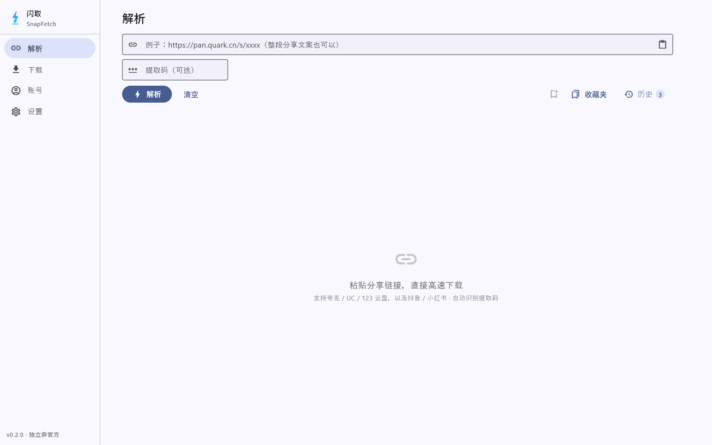

# 闪取 · SnapFetch

> 粘贴分享链接，直接高速下载 —— 一款开源、免费的 **Windows 桌面**下载工具。

[](./LICENSE)
[]()
[](https://flutter.dev)
[](https://github.com/ElioChen240/snapfetch/releases/latest)
[](./CHANGELOG.md)



## 功能

**解析**
- 粘贴网盘分享链接（整段文案、带提取码均可），自动识别平台
- 独立提取码输入框（链接里没带提取码时手动补），支持从剪贴板一键粘贴
- 收藏夹：主动存下的链接；解析历史：自动记录每次解析（含失败原因），点击可复用
- 网盘：夸克、UC、123 云盘
- 只做网盘：视频平台解析（抖音 / 小红书）已下架

**浏览**
- 进入式文件浏览：点文件夹进入、面包屑跳转、返回上一级
- 文件夹整体勾选、跨目录保持选中状态

**下载**
- Range 分片并发（默认 8，可调 1~32）+ 断点续传
- 暂停 / 继续 / 删除，任务重启后恢复
- 完成后可一键打开所在文件夹
- 「免转存下载」开关（默认开）：解析出直链直接下，不往你的网盘里塞文件

**账号**
- 应用内登录（内嵌 WebView2），无需手动复制 Cookie
- 登录后可浏览自己网盘里的文件并直接下载
- 账号卡片显示昵称与容量用量
- 凭证经 Windows DPAPI 加密，仅本机可解

## 下载安装

前往 [Releases](https://github.com/ElioChen240/snapfetch/releases/latest) 下载：

| 形态 | 文件 | 说明 |
| --- | --- | --- |
| 便携版 | `SnapFetch-<版本>-win64-portable.zip` | 解压即用，免安装（约 34 MB） |
| 安装版 | `SnapFetch-<版本>-setup.exe` | 每用户安装，可卸载 |
| 校验和 | 上述文件的 `.sha256` | 未签名阶段请自行核对来源 |

要求：Windows 10/11 x64。应用内登录需要 WebView2 Runtime（Win10/11 一般已内置，
缺失时包内附 `MicrosoftEdgeWebview2Setup.exe`）。

## 使用

1. 「账号」页登录网盘（需要登录才能取链的平台）
2. 「解析」页粘贴分享链接 → 勾选文件 → 下载所选
3. 「下载」页查看进度，完成后点文件夹图标定位文件

默认下载目录是你的「**下载**」文件夹，可在设置里改成任意目录；
改过一次之后程序严格按你设置的目录存，不会静默改存到别处。

## 构建

环境：Flutter 3.44+、Visual Studio 2022 Build Tools（C++ 桌面开发）、Windows 10 SDK、NuGet CLI。

```powershell
flutter pub get
flutter analyze            # 应无 issue
flutter test               # 68 个用例
flutter run -d windows     # 开发运行
```

打包分发（版本号真源是 `pubspec.yaml`，脚本自动读取并注入安装包）：

```powershell
.\tools\portable-package.ps1 -Build    # 便携版 zip + sha256（会先清空旧构建产物）
.\tools\build-installer.ps1            # 安装版 setup.exe（需装 Inno Setup 6/7）
```

> 别直接拿旧的 `Release` 目录打包：`flutter build` 不会删除上次留下的文件，
> 已删依赖的 DLL 会被原样带进分发包。脚本内置了陈旧检查，
> 详见 [docs/DISTRIBUTION.md](./docs/DISTRIBUTION.md)。

发布走 CI：打 tag `v0.2.0` 推送后，`.github/workflows/build-windows.yml`
自动构建并把两件套 + 校验和挂到 GitHub Release（正文取 `CHANGELOG.md`）。

## 已知问题

- **未签名 exe 可能被安全软件拦截**：火绒等 HIPS 会阻止未签名程序写入用户目录，
  表现为下载报「拒绝访问」。把 `SnapFetch.exe` 加入信任区即可，或使用默认下载目录。
- **平台接口随时可能变化**：解析逻辑集中在 `lib/data/parsers/`，单个平台失效只需改对应文件。
- 各平台的实际可用性以你自己的账号为准，部分接口可能需要登录态。

## 协议与声明

- 本项目基于 **GNU AGPL-3.0** 开源，详见 [LICENSE](./LICENSE)。
- **独立实现、非官方**：与「云析 YunX」及其官方 PC 版无隶属关系，未复制其代码。
  功能设计参考了 [CYQawa/YunX](https://github.com/CYQawa/YunX) 与
  [tidain/YunX-Desktop](https://github.com/tidain/YunX-Desktop)（均为 AGPL-3.0）。
- **仅供个人学习与技术交流，请勿用于商业用途。** 下载内容版权归原作者所有，
  请遵守所在地法律与相关平台服务条款。使用第三方网盘可能触发账号风控，风险自负。
- 不提供：破解付费内容、账号共享、绕过平台付费限制。
- **平台图标**：仓库内**不含**任何平台 logo 图片（注册商标，不随分发包传播）。
  想要手机版那种真实图标，本机跑一次
  `powershell -File tools/fetch-platform-icons.ps1`（从各平台官网取图）；
  没跑则自动改用自绘的「品牌色块 + 首字」，功能与识别度等价。
  文中出现的产品名称商标权归各自所有者。

## 技术栈

Flutter 3.44 / Dart 3.12 ｜ Material 3 ｜ Riverpod ｜ Dio ｜
flutter_inappwebview（WebView2 登录）｜ win32 DPAPI（凭证加密）｜
media_kit（预览，暂无入口）｜ Inno Setup + PowerShell 打包

持久化刻意保持轻：设置 / 任务 / 收藏 / 历史都是 JSON 文件，
凭证是 DPAPI 密文，没有数据库依赖。

## 文档

- [docs/PRD.md](./docs/PRD.md) —— 需求、红线、验收标准、决策记录
- [docs/TECH_PLAN.md](./docs/TECH_PLAN.md) —— 架构与逐平台实现说明
- [docs/UI_DESIGN.md](./docs/UI_DESIGN.md) —— Material 3 视觉与动效规范
- [docs/DISTRIBUTION.md](./docs/DISTRIBUTION.md) —— 打包、发布、发布前检查清单
- [CHANGELOG.md](./CHANGELOG.md) —— 版本变更
